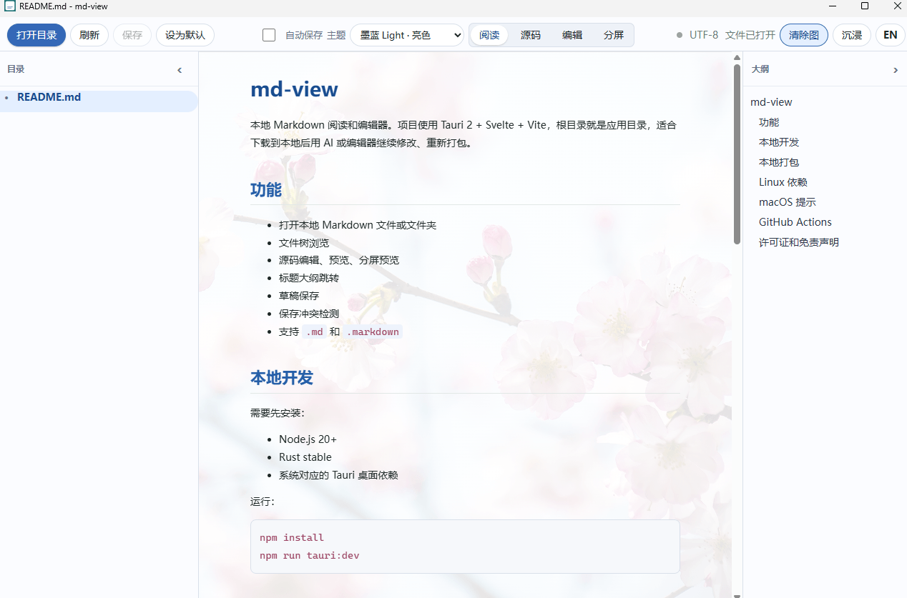

# md-view

[简体中文](README.md)

A lightweight Markdown reader and editor that keeps your files on your device. Open a README or a folder of documents, and switch between reading, source editing, visual editing and split preview.

[Download v1.2.1](https://github.com/T-meow/md-view/releases/tag/v1.2.1) · [Website](https://t-meow.github.io/md-view/en/) · [Online demo](https://t-meow.github.io/md-view/play/) · [Changelog](CHANGELOG.md)

## Download and get started

Choose your system and edition from [GitHub Releases](https://github.com/T-meow/md-view/releases/latest):

| System | Download | How to run |
| --- | --- | --- |
| Windows x64 | `md-view-lite_1.2.1_windows-x64-portable.exe` or `md-view-plus_1.2.1_windows-x64-portable.exe` | Run the downloaded executable; the system needs the WebView2 runtime |
| macOS Apple Silicon | A `.dmg` starting with `md-view-lite_1.2.1_` or `md-view-plus_1.2.1_` | Open the disk image and drag the app into Applications |

These are the platforms with published binaries. Linux and Intel Mac binaries are not included. The macOS app is unsigned and not notarized, so the system may block the first launch.

Create a document, open one or more files, open a folder, or drag files into the app. Local Markdown links open the target document in an app tab; other local files and folders open with their system default application, and website links open in your system browser. Press `Ctrl+S` to save. Closing an unsaved document prompts you to handle the changes.

## What's new in 1.2.1

- **Local file links**: Markdown opens in app tabs. Other local files and folders, including `.godot` projects and `.cmd` launchers, open with their system default application.
- **Launcher working directory**: local files open from their containing directory, supporting Unicode, spaces and relative paths. Opening failures are reported in the app.
- **Middle-click handling**: middle-clicks use the same link handling as regular clicks, avoiding unintended browser navigation. Protocol-relative web links use HTTPS.

See the [changelog](CHANGELOG.md) and [manual acceptance examples](docs/ui-update-checklist.md) for details.

## Lite and Plus

Both editions share the desktop interface, file management and saving behavior. Choose the rendering features you need.

| Feature | Lite | Plus |
| --- | --- | --- |
| Local folders, tabs, new files and drag and drop | ✓ | ✓ |
| Reading, source, visual editing and split view | ✓ | ✓ |
| Adaptive sidebars, outline and local document links | ✓ | ✓ |
| Tables, task lists, code copying and wrapping | ✓ | ✓ |
| Themes, backgrounds, Chinese / English, drafts and save-conflict prompts | ✓ | ✓ |
| Quick open for open, recent and loaded files | ✓ | ✓ |
| Math, Mermaid, Frontmatter, footnotes and advanced syntax | — | ✓ |
| Workspace heading index, local link checks and HTML export | — | ✓ |



## Local files and saving

- Opening a single file reads only that document. Folders load one level at a time, and the tree renders visible rows. Workspace indexing starts on demand.
- Drafts and saved files are separate. **Automatic disk writeback is off by default.** Saving checks whether the file changed on disk to avoid silently overwriting external edits.
- Saving preserves existing UTF-8, GBK or UTF-16 encoding, BOM and line endings. Documents larger than 2 MiB open in source mode by default.
- File scanning respects `.gitignore`, `.ignore` and custom exclusions, and does not traverse symbolic links or junctions by default.
- Visual editing preserves original Markdown for untouched blocks where possible. Use source mode for complex syntax; visual editing undo history is not persisted across tabs.

The online demo processes imported text in your browser and provides source editing, previews and download exports. Use the desktop app for direct file access, folder management and drafts. Remote images in documents are still loaded from their original URLs.

## Keyboard shortcuts

| Action | Windows / Linux |
| --- | --- |
| New document | `Ctrl+N` |
| Open files | `Ctrl+O` |
| Quick open | `Ctrl+P` |
| Save / Save as | `Ctrl+S` / `Ctrl+Shift+S` |
| Close current tab | `Ctrl+W` |
| Next / previous tab | `Ctrl+Tab` / `Ctrl+Shift+Tab` |

On macOS, use the corresponding `Command` shortcuts for new, open, quick open, save and close.

## Development and builds

Built with Tauri 2, Svelte and Vite. Development requires Node.js 24, stable Rust (at least 1.88) and the Tauri desktop dependencies for your operating system.

```bash
npm ci
npm run tauri:dev          # Plus
npm run tauri:dev:lite     # Lite
```

Common build commands:

```bash
# Windows portable app; replace plus with lite for Lite
npm run tauri:build:plus -- --no-bundle

# Windows NSIS installer (the default bundle target)
npm run tauri:build:plus

# macOS DMG (run on macOS)
npm run tauri:build:plus -- --bundles dmg

# Website and online demo
npm run build:web
npm run check:web
```

Desktop output goes to `src-tauri/target/release/`, with consistently named distribution files copied to `release/`. The website and demo are built into `dist-site/`. Their default base path is `/md-view/`, configurable through `VITE_BASE_PATH`.

Checks before committing:

```bash
npm run check
npm test
npm run check:editions
cargo test --manifest-path src-tauri/Cargo.toml --lib --locked
git diff --check
```

GitHub Actions checks and builds both editions for Windows and macOS on branch updates. Pushing a `v*` tag creates a draft release with binaries for review before publication. Updates to `main` deploy the Chinese and English website and the online demo to GitHub Pages.

See the [development notes](docs/load-performance-plan.md) for the architecture and file-loading design.

## Feedback and license

Report problems through [GitHub Issues](https://github.com/T-meow/md-view/issues), including your system, version, reproduction steps and a minimal document with private information removed. This project does not accept PRs. You are welcome to fork, modify, build and distribute it for your needs.

By [T-meow](https://github.com/T-meow), under [WTFPL v2](LICENSE). Provided as is, without express or implied warranties. You assume the risks of using, modifying and distributing it.
